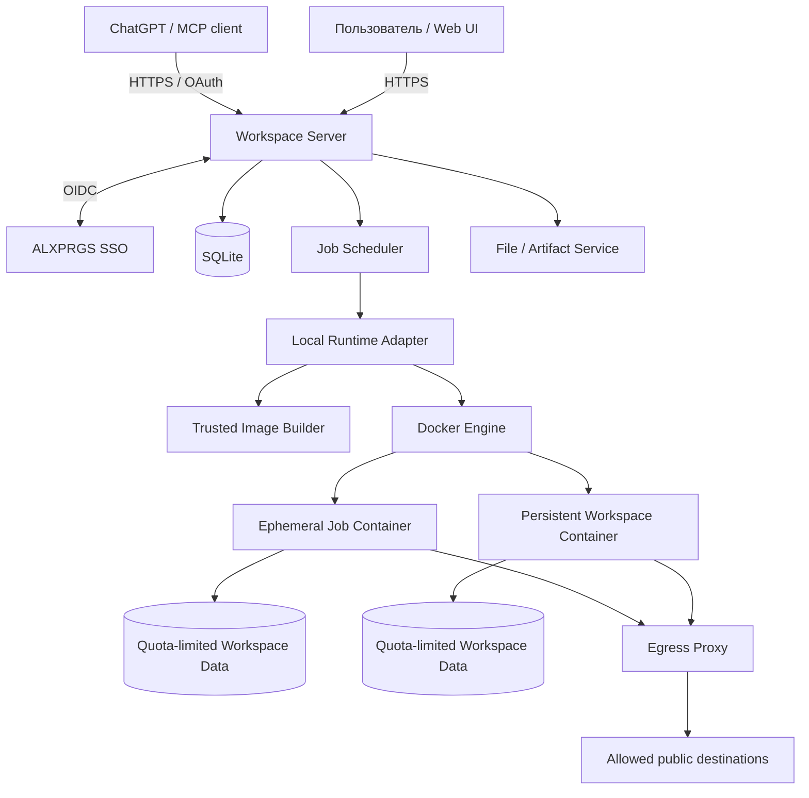
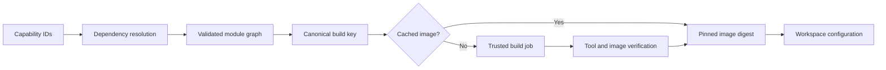

# ALXPRGS Workspace — Architecture

| Параметр | Значение |
|---|---|
| Продукт | ALXPRGS Workspace |
| Репозиторий | `alxprgstech/workspace` |
| Целевая версия | `0.1.0` |
| Редакция документа | `1.0` |
| Статус | Approved — архитектурные решения утверждены; реализация не проверена |
| Дата | 2026-11-25 |
| Основной документ | [MVP.md](MVP.md) |

## 1. Назначение документа

Документ определяет техническую архитектуру ALXPRGS Workspace 0.1.0. Основной сценарий — выполнение полного цикла разработки, сборки и тестирования программного обеспечения через MCP в обычном веб-чате ChatGPT.

Приоритеты: экономия ресурсов хоста, изоляция недоверенного кода, воспроизводимость окружений, Linux и Windows, совместимость с ALXPRGS SSO и официальной документацией OpenAI.

Утверждённые решения:

| Область | Решение |
|---|---|
| Жизненный цикл | Временный контейнер на Job и сохраняемый контейнер на Workspace с остановкой при простое |
| Linux runtime | Отдельный Docker Engine в Rootless Mode |
| Windows runtime | Выделенный WSL2-дистрибутив с Docker Engine |
| Capabilities | Динамическое формирование Docker-образов из доверенных модулей |
| Сеть | Изолированная сеть и контролируемый egress proxy |
| Хранилище | Жёсткие файловые квоты; запрет исполнения при невозможности их обеспечить |

Документ фиксирует архитектурные решения, но не свидетельствует о завершении реализации или технической приёмки. Указанные ниже внутренние имена и контракты предварительны до фиксации в профильной документации.

## 2. Архитектурный подход

Используется модульный монолит на Rust Edition 2024. Один самостоятельный экземпляр обслуживает несколько рабочих пространств на одном вычислительном устройстве.

Логические компоненты:

- Control Plane и HTTP API.
- MCP Gateway.
- Authentication.
- Workspace Manager.
- Capability Registry и Image Builder.
- Job Scheduler и Job Manager.
- Docker Runtime.
- Storage Manager и File Service.
- Artifact Service.
- Network Policy и Egress Proxy.
- Resource Manager.
- Web Administration и Audit.



Диаграмма отражает логическую структуру, а не обязательное количество процессов. На Windows операции с Docker и Linux filesystem выполняются через доверенный локальный helper внутри WSL2.

Redis, PostgreSQL, Kubernetes, внешние брокеры сообщений и распределённые Workers не требуются для MVP.

## 3. Структура проекта

Предлагается единый Cargo Workspace:

```text
workspace/
├── crates/
│   ├── workspace-core/
│   ├── workspace-server/
│   ├── workspace-runtime/
│   └── workspace-cli/
├── images/
│   ├── base/
│   ├── modules/
│   └── manifests/
├── deploy/
│   ├── linux/
│   └── windows/
├── docs/
├── tests/
├── Cargo.toml
├── Cargo.lock
├── config.example.toml
├── AGENTS.md
└── README.md
```

| Crate | Ответственность |
|---|---|
| `workspace-core` | Доменные модели, состояния, ограничения и интерфейсы |
| `workspace-server` | HTTP, MCP, OAuth, SQLite, планирование и веб-панель |
| `workspace-runtime` | Docker, локальный helper, сборка образов, хранение и изоляция |
| `workspace-cli` | Точка входа, конфигурация, диагностика и администрирование |

Зависимости должны быть однонаправленными. Доменные модели не зависят от Axum, MCP или Docker. Разделение на crates не означает запуск отдельного процесса для каждого компонента.

Основной сервер и CLI могут поставляться одним бинарником; Linux helper для Windows собирается отдельно из общего Rust-кода.

## 4. Поддерживаемые платформы

### 4.1. Linux

Workspace Server работает нативно на Linux x86-64. Для исполнения используется отдельный Docker Engine в Rootless Mode под выделенной непривилегированной учётной записью.

Обязательны cgroups v2, systemd, необходимые делегированные контроллеры и подтверждение применения CPU, RAM, swap и PID limits. Docker daemon production-сервисов не используется в качестве неограниченного вычислительного backend.

Данные, ключи OAuth, управляющие сокеты и файлы production-сервисов недоступны вычислительным контейнерам. Административная подготовка хоста выполняется вне MCP.

### 4.2. Windows

Workspace Server работает нативно на Windows x86-64. Для исполнения используется выделенный WSL2-дистрибутив с Docker Engine. Docker Desktop не является обязательной зависимостью.

Внутри WSL2 размещаются:

- Docker Engine с непривилегированным режимом исполнения и изолированным контуром управления;
- доверенный локальный Runtime Helper;
- рабочие данные и кеши;
- хранилище образов;
- механизмы квотирования и сетевой изоляции.

Один Linux backend обслуживает несколько пространств. Отдельная VM на каждое пространство не создаётся.

Рабочие данные размещаются в Linux filesystem, а не в `/mnt/c` и других автоматически подключаемых Windows-дисках. Автоматическое подключение дисков и Windows interop в вычислительном контуре отключаются. Управляющий интерфейс helper не предоставляет произвольный запуск команд хоста.

Канал между Windows Server и helper должен быть локальным, аутентифицированным и типизированным. Docker API не публикуется по незащищённому TCP. Необходимость запуска WSL2 в контексте отдельной Windows-учётной записи и доступность дистрибутива в режиме службы проверяются при приёмке.

Общие параметры `.wslconfig` могут влиять на другие WSL2-дистрибутивы; сервис не изменяет их автоматически. Фактическая изоляция и общий бюджет WSL2 проверяются отдельно.

### 4.3. Общие ограничения

Первая версия предоставляет Linux-пространства на обеих ОС. Нативные Windows-контейнеры и сборка под MSVC в нативном Windows-окружении не входят в MVP.

При отсутствии поддерживаемого runtime, квот или обязательной изоляции вычислительный контур переходит в состояние `not_ready`. Выполнение команд непосредственно на хосте как fallback запрещено.

## 5. Модель Workspace

Workspace — логическое пространство с собственным идентификатором, владельцем, конфигурацией и постоянными данными. Оно не обязано иметь работающий контейнер.

Сохраняются:

- идентификатор экземпляра и пространства;
- владелец и имя;
- режим исполнения;
- запрошенные и фактически подключённые capabilities;
- digest образа и версии модулей;
- политика сети и её ревизия;
- ограничения ресурсов;
- рабочие файлы, кеши и история заданий;
- TTL, признак закрепления, время последней активности;
- состояние подготовки образа и runtime.

Чтение и изменение файлов, импорт вложений и публикация артефактов не требуют запуска вычислительного контейнера. Для этих операций используются доверенные файловые компоненты.

Состояния пространства: `created`, `preparing`, `starting`, `running`, `idle`, `stopping`, `stopped`, `failed`, `deleting`, `expired`. Точная таблица переходов должна быть описана в контрактах реализации.

Подготовка нового образа может выполняться асинхронно. До её завершения команды не запускаются. `workspace_info` показывает ход подготовки и причину ошибки при её наличии.

## 6. Режимы исполнения

Поддерживаются оба режима. Выбор режима осуществляется при создании Workspace; при отсутствии явного выбора применяется `ephemeral`.

Предлагаемый параметр MCP: `execution_mode` со значениями `ephemeral` и `persistent`. Окончательная схема фиксируется в `MCP.md`.

### 6.1. Ephemeral — временный контейнер на Job

Для каждого задания создаётся новый контейнер из зафиксированного образа. Постоянные данные пространства подключаются к нему на время исполнения.

Жизненный цикл:

1. Проверить авторизацию, квоты, политику сети и готовность образа.
2. Создать запись Job и зарезервировать ресурсы.
3. Создать изолированный сетевой контекст и контейнер.
4. Выполнить команду, сохранить stdout, stderr и результат.
5. Завершить все процессы задания, удалить контейнер и его временные ресурсы.
6. Освободить вычислительный бюджет и сохранить итоговый статус.

Рабочие файлы, Cargo target, зависимости и другие разрешённые кеши сохраняются между заданиями. Память процессов, фоновые процессы, `/tmp`, состояние shell и переменные окружения отдельной команды не сохраняются.

После завершения Job не остаётся простаивающего вычислительного контейнера. Это основной режим для компиляции, тестирования, обработки файлов и сценария ClipForge.

### 6.2. Persistent — один контейнер на Workspace

Для пространства создаётся контейнер, который переиспользуется несколькими последовательными заданиями.

В отсутствие активных заданий контейнер переходит в `idle` и автоматически останавливается после настроенного таймаута (по умолчанию 300 секунд). При новом задании он запускается повторно или безопасно пересоздаётся при необходимости.

Контейнер не закрепляет за собой неограниченные ресурсы. Его выделенный CPU/RAM/PID-бюджет учитывается всё время, пока он запущен, включая простой. При недостатке ресурсов планировщик может остановить простаивающие контейнеры раньше установленного таймаута.

В рамках текущего запуска контейнера могут существовать процессы и временные файлы между последовательными заданиями. Однако:

- фоновые процессы не получают права обходить таймер простоя, лимиты и максимальное время работы;
- после остановки или пересоздания все процессы завершаются, оперативная память и временные данные теряются;
- отдельные вызовы `exec` не обязаны разделять состояние shell, рабочую директорию и переменные окружения;
- сохранение данных гарантируется только в разрешённых постоянных областях;
- root filesystem остаётся read-only.

Отмена или превышение таймаута Job должны гарантированно прекращать соответствующее вычисление и его дочерние процессы. Для MVP допускается остановка всего persistent-контейнера, с явным отражением этого последствия в статусе задания. Последующее задание может автоматически восстановить контейнер.

Этот режим предназначен для задач, где переиспользование работающего окружения полезнее немедленного освобождения ресурсов. Он не является неограниченной интерактивной shell-сессией.

### 6.3. Общие правила режимов

| Свойство | Ephemeral | Persistent |
|---|---|---|
| Контейнер | На каждое Job | На Workspace |
| После завершения Job | Удаляется | Переходит в idle |
| Освобождение CPU/RAM | Сразу после завершения и очистки | После остановки контейнера |
| Рабочие файлы и кеши | Сохраняются | Сохраняются |
| Фоновые процессы между Job | Нет | Возможны до остановки, под лимитами |
| Состояние shell между вызовами | Не гарантируется | Не гарантируется |
| Повторный запуск | Новый контейнер | Запуск или пересоздание |
| Режим по умолчанию | Да | Нет |

Не более одного активного Job на Workspace в обоих режимах. Разные пространства могут выполнять задания параллельно в пределах глобального бюджета.

Изменение режима допускается только при отсутствии активных и ожидающих заданий пространства, после остановки и удаления прежнего вычислительного контейнера. Рабочие файлы и кеши сохраняются. Смена режима не расширяет разрешения.

`workspace_stop` завершает вычислительную активность пространства согласно документированной семантике отмены, прекращает ожидающие задания и сохраняет данные. `workspace_delete` дополнительно удаляет данные, но не опубликованные артефакты.

### 6.4. TTL и закрепление

TTL применяется к логическому пространству, а idle timeout — к работающему контейнеру. Эти механизмы независимы.

Предлагаемые значения из MVP: TTL 24 часа с последней значимой активности; idle timeout 300 секунд. Периодический опрос статуса не должен бессрочно продлевать TTL. Активное задание или операция с данными защищает пространство от удаления на время операции; зависшие операции ограничиваются таймаутами.

Закрепление отключает автоматическое удаление по TTL, но не отменяет остановку контейнера, квоты, таймауты и административные ограничения. Артефакты имеют собственный TTL.

## 7. Политика Docker

Контейнеры создаются только на основании проверенной конфигурации сервера. MCP-клиент не может передавать произвольные Docker flags, mounts, devices, network settings или security options.

Обязательные меры:

- непривилегированный пользователь контейнера;
- rootless Docker на Linux и эквивалентно проверенный непривилегированный контур в WSL2;
- read-only root filesystem;
- `no-new-privileges`, минимальный набор Linux capabilities и seccomp;
- запрет privileged mode, host network, host PID/IPC, произвольных устройств;
- запрет Docker socket и управляющих интерфейсов внутри контейнера;
- ограниченный tmpfs и только разрешённые записываемые области с квотами;
- поддерживаемые платформой дополнительные механизмы защиты, например AppArmor;
- отсутствие входящих опубликованных портов в MVP.

Доверенный Docker adapter ограничивает набор операций. Обычная контейнерная изоляция не эквивалентна VM; остаточные риски документируются в `SECURITY.md`.

## 8. Capability Registry и динамическое формирование образов

### 8.1. Каталог модулей

Вместо фиксированного набора профилей сервис динамически собирает окружение под запрошенные capabilities.

Обязательные возможности из MVP:

| ID | Состав |
|---|---|
| `base` | Bash, coreutils, find, grep, tar, unzip, curl, CA certificates |
| `rust` | rustc, Cargo, rustfmt, Clippy |
| `cpp` | GCC, G++, CMake, Ninja, pkg-config |
| `git` | Git |
| `python` | Python, pip, venv |
| `ffmpeg` | FFmpeg, FFprobe |
| `whisper-vad` | Whisper.cpp VAD и совместимая модель Silero |

`base` подключается автоматически. Каждый модуль имеет административно управляемый manifest: ID, версию, список инструментов, зависимости, совместимость, конфликты, доверенный рецепт сборки, источники и контрольные суммы необходимых ресурсов.

Сетевой режим, лимиты и разрешения не являются пакетами Docker-образа и назначаются независимо. Подключение `rust` или `git` само по себе не разрешает интернет.

### 8.2. Сборка образа

MCP-клиент указывает идентификаторы возможностей, а не Dockerfile, команды установки на хосте или произвольные build arguments.



Последовательность подготовки:

1. Проверить доступность, версии, зависимости и конфликты модулей.
2. Построить детерминированный граф модулей и каноническую спецификацию сборки.
3. Вычислить ключ кеша с учётом платформы, digest базового образа, версий и хешей рецептов, конфигурации сборки и формата спецификации.
4. Найти соответствующий проверенный локальный образ.
5. Если образ отсутствует, поставить доверенную сборку в отдельную ограниченную очередь.
6. Проверить результат сборки, фактические версии инструментов и наличие обязательных моделей.
7. Зафиксировать digest готового образа и привязать его к Workspace.

Два одинаковых запроса не должны запускать две независимые сборки одного образа. При несовместимости модулей сервис возвращает диагностическую ошибку, а не silently выбирает другое окружение.

### 8.3. Безопасность сборки

Рецепты модулей и базовые образы управляются администратором. Пользовательские исходники и файлы Workspace не передаются в контекст доверенной сборки образов.

Образы и пакеты берутся из разрешённых источников; версии и digest фиксируются, контрольные суммы проверяются там, где они предусмотрены. Политика обновления и воспроизводимость сборки должны быть документированы, включая ограничения внешних репозиториев.

Сборщик работает отдельно от вычислительных контейнеров, с собственными CPU/RAM/PID/дисковыми лимитами и контролируемым сетевым доступом. Требуется подтвердить реальное применение ограничений также к процессам BuildKit или выбранного доверенного сборщика. Не допускаются привилегированные сборки, host network, произвольные entitlements и передача секретов Workspace в слои образа.

Если обязательные ограничения сборщика не обеспечиваются, динамическая сборка блокируется. Подготовленные и проверенные ранее образы могут использоваться при соблюдении всех остальных политик.

### 8.4. Кеширование и очистка

Docker использует общие неизменяемые слои базовых образов и модулей там, где совпадает содержимое и это допускает структура сборки. Кеши сборки ограничиваются глобальным дисковым бюджетом.

Не гарантируется, что произвольные комбинации модулей будут иметь одинаковые слои. Оптимизация не должна приводить к созданию всех возможных комбинаций заранее.

Идентичные спецификации переиспользуют готовый образ. Администратор может прогревать наиболее востребованные комбинации. Образы, закреплённые за существующими Workspace, не удаляются автоматической очисткой до освобождения всех ссылок. Неиспользуемые образы и build cache очищаются по ограниченному бюджету.

Изменение версии модуля не должно незаметно менять окружение существующего пространства. Изменение набора capabilities допускается через контролируемое обновление остановленного пространства, с повторной подготовкой образа и сохранением рабочих файлов. Политика совместимости кешей при смене образа фиксируется в реализации; зависимые от toolchain кеши могут быть сброшены.

## 9. Файловое хранилище

Предлагаемая логическая структура:

```text
data/
├── state/
│   └── workspace.db
├── auth/
├── workspaces/
│   └── <workspace_id>/
│       ├── files/
│       └── cache/
├── artifacts/
├── logs/
└── staging/
```

На Windows метаданные и ключи управляющего приложения могут храниться на стороне Windows, а рабочие файлы, кеши и Docker data — внутри выделенного Linux-хранилища. Это разделение прозрачно для API.

Пути внутри контейнера:

| Путь | Назначение |
|---|---|
| `/workspace` | Исходники и результаты |
| `/cache` | Постоянные кеши конкретного Workspace |
| `/tmp` | Ограниченная временная область |
| `/opt/tools` | Неизменяемые инструменты при необходимости |

Cargo Registry, Cargo target и другие разрешённые кеши направляются в области с квотой. Общие записываемые кеши между независимыми пространствами запрещены. Допустимы доверенные неизменяемые общие ресурсы, не содержащие пользовательских данных.

Storage Manager или локальный helper выполняет файловые операции без предоставления произвольного доступа к путям хоста. Проверки должны исключать path traversal, symlink/hardlink escape, специальные файлы и TOCTOU-гонки. В Linux предпочтительны операции относительно открытого дескриптора корневой директории с безопасным разрешением путей. Конкретная реализация подлежит проверке.

В persistent-режиме операции записи, импорта и публикации должны учитывать возможность фоновых изменений. Для согласованной публикации и чувствительных файловых операций контейнер при необходимости останавливается или используется проверенный механизм получения неизменяемого снимка. Простая проверка пути или предварительного размера не заменяет безопасное открытие файла.

## 10. Жёсткие дисковые квоты

Все доступные для записи области имеют реальные ограничения, обеспечиваемые файловой системой или механизмом ограниченного временного хранилища.

Основной кандидат для Linux и WSL2 — project quotas на ext4 или XFS. Это кандидат на реализацию, а не подтверждённая совместимость конкретного WSL2-ядра или файловой системы.

Квотирование охватывает:

- рабочие файлы, кеши и количество inode/файлов;
- временные области и промежуточные загрузки;
- логи заданий;
- опубликованные артефакты;
- Docker data, образы и кеш сборщика;
- глобальный объём выделенного хранилища.

При необходимости применяются отдельные ограниченные файловые системы или другие проверенные механизмы жёсткого квотирования. Подготовка файловой системы выполняется администратором или ограниченным локальным helper с минимальными полномочиями. MCP не предоставляет доступ к настройке mount, loop devices и квот хоста.

Периодическое измерение размеров каталога не является жёсткой квотой. Параметры Docker storage driver сами по себе не обеспечивают ограничение всех подключённых volumes или bind mounts.

При невозможности применить и проверить обязательные квоты вычислительные задания, сборка новых образов и операции записи, способные превысить незащищённый бюджет, блокируются. Сервис не должен переходить к неограниченному исполнению.

## 11. Job Scheduler

Очередь заданий и резервы ресурсов хранятся в SQLite. Внешний брокер не нужен.

Проверяются глобальные и индивидуальные лимиты CPU, RAM, swap, PID, диска, максимальное число активных контейнеров, состояние runtime и число ресурсоёмких операций. Сборка образов включается в планирование и не может бесконтрольно выполняться параллельно с пользовательскими заданиями.

Ресурсы резервируются атомарно до запуска. Для persistent-контейнера резерв удерживается до его фактической остановки. После очистки ресурсов резерв освобождается. При необходимости простаивающий persistent-контейнер останавливается перед запуском ожидающего задания.

Job поддерживает состояния `queued`, `running`, `succeeded`, `failed`, `cancelled`, `timed_out`, `interrupted`. Длительные операции возвращают идентификатор задания; их исполнение не зависит от продолжительности HTTP-запроса.

Обязательны stdout, stderr, код выхода, ограниченные логи, чтение с позиции, таймаут и отмена. Для отмены ephemeral Job уничтожается его контейнер; для persistent Job допускается остановка всего контейнера. Успешный HTTP-ответ не означает успешное выполнение команды.

## 12. Восстановление после сбоев

Контейнеры, сети и другие ресурсы получают серверные labels с Instance ID и Workspace ID, а для временного контейнера — также Job ID. Постоянный контейнер идентифицируется независимо от конкретного задания. Все имена формируются сервером.

Запись операции создаётся до обращения к Docker. При старте сервиса выполняется reconciliation:

- сопоставление ресурсов Docker с метаданными;
- проверка актуальности reservations, квот и сетевой политики;
- безопасная остановка и удаление осиротевших ресурсов своего экземпляра;
- сверка состояния подготовки образов;
- восстановление подтверждённого состояния заданий;
- перевод заданий с неподтверждённым результатом в `interrupted`.

Если активное исполнение невозможно безопасно идентифицировать или контролировать после сбоя, оно останавливается. Автоматический повтор произвольной пользовательской команды запрещён.

Idempotency keys привязываются к экземпляру, авторизованному субъекту/подключению, операции и каноническим аргументам. Повтор того же запроса не создаёт дубликат; повтор ключа с другими аргументами отклоняется.

## 13. Сетевая архитектура

### 13.1. Режимы

- `none`: внешняя сеть отключена.
- `allowlist`: изолированная сеть, выход только через доверенный egress proxy.

`none` используется по умолчанию. Allowlist управляется администратором; MCP-клиент не расширяет её самостоятельно.

### 13.2. Изоляция

В режиме `allowlist` контейнер подключается к отдельному изолированному сетевому контексту, из которого разрешено соединение только с назначенным прокси. Прямой выход в интернет, доступ к хосту и другим Workspace блокируются техническими средствами.

Для ephemeral создаётся сетевой контекст задания, для persistent — пространства на время его запуска. Прокси связывает запросы с конкретным контекстом и его действующей политикой. Привилегии прокси и доступ к внешней сети отделены от пользовательских контейнеров. Использование общей сети без межконтейнерной изоляции не допускается.

Переменные `HTTP_PROXY` и `HTTPS_PROXY` предназначены для удобства клиентов, но не считаются механизмом защиты. Необходимо проверить невозможность прямых TCP/UDP-соединений, обхода через DNS, IPv6, шлюз, служебные адреса и взаимодействие между пространствами.

### 13.3. Egress Proxy

Прокси проверяет разрешённые имена, порты и фактические IP-адреса назначения; запрещает приватные, loopback, link-local, metadata и другие внутренние/служебные адреса, включая публичные адреса собственных управляющих сервисов. При разрешении DNS проверяются конечные адреса, а соединение устанавливается только с проверенным адресом. Политика применяется к каждому новому соединению, включая новые назначения после перенаправлений.

Поддерживаются ограничения числа соединений, таймаутов и объёма передаваемых данных. CONNECT разрешается только для утверждённых назначений и портов. TLS MITM не входит в MVP.

Для Git, Cargo, pip и источников моделей необходимо явно разрешить требуемые registry/CDN/redirect endpoints. Расширение Allowlist по запросу модели требует административного действия.

Доменная Allowlist не является защитой от любой утечки данных: разрешённый HTTPS-сервис потенциально может принимать произвольные данные. Этот риск должен быть отражён в модели угроз. Секреты и production-данные в вычислительные пространства не передаются.

Изменение политики должно закрывать уже установленные запрещённые соединения либо останавливать затронутые контейнеры. При невозможности гарантировать изоляцию сетевой запуск блокируется.

### 13.4. Сеть сборщика и File Service

Доверенная динамическая сборка образов использует отдельную административную сетевую политику. Она не предоставляет контейнеру доступа к дополнительным доменам после создания образа.

Импорт произвольного внешнего URL подчиняется Allowlist. Импорт вложений ChatGPT использует отдельную доверенную политику File Service с проверкой источников, перенаправлений, фактических адресов и ограничений размера. Вложения могут импортироваться даже в offline Workspace.

## 14. Управление ресурсами

Docker и Linux cgroups обеспечивают индивидуальные ограничения CPU, памяти, swap и PID. Служебные процессы, egress proxy, Docker, сборщик и файловые операции получают отдельные административные лимиты либо включаются в общий бюджет.

| Ресурс | Основной механизм |
|---|---|
| CPU | cgroups / Docker CPU quota |
| RAM и swap | cgroups / Docker memory limits |
| PID | cgroups PID limit |
| Временное хранилище | Ограниченный tmpfs |
| Постоянное хранилище | Жёсткие файловые квоты |
| Логи | Максимальный размер, ротация, TTL |
| Время выполнения | Job watchdog |
| Параллельность | Job Scheduler |
| Общая нагрузка | Глобальный бюджет экземпляра и хоста |

При размещении нескольких экземпляров совокупные ресурсы ограничиваются отдельным бюджетом хоста либо явно распределёнными административными лимитами, которые не перекрываются бесконтрольно.

Предварительный профиль ALX-3 из MVP: 2 CPU, 4096 МиБ RAM, 40 ГиБ хранилища, до 3 активных пространств, 1 тяжёлая сборка одновременно, 256 PID на пространство, максимальная длительность Job 3600 секунд. Эти параметры настраиваются и уточняются по реальным измерениям. Для управляющего сервиса сохраняется цель до 100 МиБ RAM в простое; потребление Docker, WSL2, helper и proxy измеряется отдельно и включается в итоговую оценку.

Ephemeral-режим освобождает вычислительный бюджет после каждого Job. Persistent-режим удерживает бюджет, пока контейнер работает, и освобождает после остановки. При дефиците ресурсов новые задания ожидают либо отклоняются.

## 15. MCP Gateway

Используется официальный MCP Rust SDK (`rmcp`) со Streamable HTTP. Предлагаемый endpoint — `/chatgpt/mcp`.

Gateway проверяет access token и scopes, валидирует JSON Schema, ограничивает размеры запросов и ответов, маршрутизирует вызовы и возвращает структурированные результаты. Аннотации инструментов соответствуют реальному поведению; изменяющие состояние операции не маркируются как read-only.

Сохраняется набор 21 инструмента из MVP. Новые архитектурные решения отражаются в существующих контрактах:

- `capabilities_list`: модульный каталог, версии, зависимости, доступность;
- `workspace_create`: режим исполнения, набор capabilities и подготовка образа;
- `workspace_info`: режим исполнения, digest образа, состояние подготовки и контейнера;
- `workspace_update`: контролируемое изменение режима, возможностей, TTL и закрепления;
- `exec`: выполнение в выбранном режиме, явные аргументы, рабочая директория и лимиты;
- `job_status`, `job_logs`, `job_cancel`: управление длительными заданиями;
- `file_import`: документированный OpenAI-механизм `_meta["openai/fileParams"]`;
- `artifact_download`: ограниченная по времени ссылка на опубликованный файл.

Точные аргументы, результаты, ошибки, аннотации и scopes фиксируются в `MCP.md`. Подготовка образа использует существующий механизм статуса Workspace/Job; отдельный набор MCP-инструментов для Docker не требуется.

MCP используется как управляющий протокол, HTTPS — для передачи бинарных файлов. Сервис не предполагает автоматического пробуждения ChatGPT после завершения длительного Job и не обходит ограничения клиента.

## 16. Authentication

ALXPRGS SSO используется как OIDC Identity Provider. Workspace предоставляет OAuth-слой для MCP по архитектурному образцу Notify.

Обязательны Authorization Code Flow, PKCE S256, Authorization Server Metadata, Protected Resource Metadata, Resource Indicators, проверка issuer, audience, resource и scopes, точные redirect URI, статические OAuth credentials, refresh token rotation и отзыв доступа.

Каждое развёртывание имеет независимые ключи, credentials и токены. Поддерживаются несколько OAuth-подключений с раздельными правами. Любой запрос проверяется на принадлежность объекта владельцу и действующие полномочия.

Расширение разрешений, изменение сетевой политики и административных лимитов выполняются уполномоченным пользователем. SSO step-up может использоваться для чувствительных административных действий после проверки доступности и контракта существующего SSO.

Выбор проверенной Rust-библиотеки OAuth-сервера остаётся технической задачей. Самостоятельная реализация криптографических примитивов запрещена. Полномочия MCP не предоставляют административного доступа к хосту.

## 17. File Service

Поддерживаются импорт вложений ChatGPT, загрузка по разрешённому URL, ручная загрузка через веб-панель, просмотр файлов, чтение диапазонов, создание, перезапись и применение патчей.

Импорт выполняется потоково по HTTPS через ограниченный staging. Сервис проверяет полномочия, источник, пути, фактический объём данных, доступный бюджет и безопасность архивов. Успешная загрузка публикуется в рабочую директорию атомарно там, где это поддерживается файловой системой.

Для входящих архивов запрещаются выход за пределы пространства, небезопасные ссылки и специальные файлы; ограничиваются размер после распаковки и количество файлов. Ограничения распространяются на промежуточные данные, а не только на готовый файл.

Модификации файлов сериализуются относительно активных вычислений, либо отклоняются до безопасного состояния. В persistent-режиме дополнительно учитываются фоновые процессы.

Временные URL OpenAI, токены и credentials не записываются в открытые журналы и не передаются пользовательскому контейнеру. Передача бинарных данных через текстовый контекст модели не требуется.

## 18. Artifact Service

Публикация создаёт независимую неизменяемую копию файла с метаданными владельца, Workspace ID, размером, MIME-типом, SHA-256 и TTL. Копирование выполняется с ограничением ресурсов и безопасным получением согласованного содержимого.

Артефакты хранятся вне рабочей директории и недоступны вычислительным контейнерам. Удаление пространства не удаляет опубликованные артефакты до истечения их собственного срока хранения.

Скачивание производится по ограниченной по времени защищённой ссылке. Ссылка предоставляет доступ только к одному артефакту и может быть отозвана. Истёкшие и отозванные ссылки отклоняются. Выдача, скачивание и публикация учитывают ограничения размера и хранилища.

## 19. SQLite и метаданные

SQLite — основное хранилище состояния. WAL используется на совместимой локальной файловой системе. Количество соединений ограничено; миграции версионируются.

Предлагаемые сущности:

- `instances`, `users`, `oauth_clients`, `oauth_grants`;
- `workspaces`, `jobs`, `job_attempts`;
- `image_specs`, `images`, `image_builds`, `image_references`;
- `artifacts`, `audit_events`, `idempotency_keys`;
- `resource_reservations`, `settings`.

Долгие Docker/HTTP-операции не выполняются внутри открытой транзакции SQLite. Согласованность с внешним runtime обеспечивается состояниями операций, идемпотентностью и reconciliation.

Большие бинарные объекты и полные логи хранятся в файловой системе, а не SQLite. Секреты защищаются средствами ОС и отдельной политикой хранения; они не попадают в вычислительные пространства.

## 20. Веб-панель

Минимальная панель реализуется на React, TypeScript и Vite. Production-файлы встраиваются в Rust-бинарник посредством rust-embed и обслуживаются Axum. Отдельный Node.js-процесс не требуется. Для разработки используется Vite Dev Server с проксированием API.

Разделы: Dashboard, Workspaces, Jobs, Files, Artifacts, Integrations, Settings, Audit.

Панель отображает режимы исполнения, состояния контейнеров и сборки образов, подключённые модули, расход ресурсов, TTL, закрепление, задания и логи. Поддерживаются предусмотренные MVP операции управления, загрузка файлов, скачивание артефактов, настройка Allowlist и OAuth-подключений.

Административные операции требуют проверки полномочий. Браузерные запросы с изменением состояния защищаются CSRF, сессии используют защищённые cookie. Не допускается предоставление терминала хоста.

## 21. Независимые развёртывания

Каждый экземпляр имеет уникальный Instance ID, собственные публичные адреса, порты, конфигурацию, базу данных, хранилище, OAuth-ключи, политики и ресурсный бюджет.

Контейнеры, сети и управляемые образы маркируются идентификаторами экземпляра. Сервис не должен удалять или изменять ресурсы другого экземпляра. При совместном использовании доверенного runtime необходимо обеспечить независимые области данных и запрет очистки общих ресурсов, пока они используются; предпочтителен выделенный runtime.

Несколько экземпляров могут использовать один ALXPRGS SSO, не разделяя токены Workspace. Распределённый кластер и удалённые Workers не входят в 0.1.0.

## 22. Диагностика и эксплуатация

`workspace doctor` проверяет:

- ОС, Docker Engine, rootless/непривилегированный runtime;
- WSL2 и доступность выделенного helper на Windows;
- cgroups и фактические CPU/RAM/swap/PID limits;
- квоты всех записываемых областей;
- ограничения сборщика образов и доступность базовых образов;
- сетевую изоляцию в режимах none и allowlist;
- доступность SQLite, хранилища и staging;
- ALXPRGS SSO, OAuth discovery и MCP endpoint.

Результаты диагностики разделяются на обязательные ошибки и предупреждения. При невозможности обеспечить обязательную безопасность вычислительный контур не готов к запуску.

Аварийная остановка запрещает новые задания, прекращает активные пользовательские вычисления и сборки образов, останавливает persistent-контейнеры и освобождает ресурсы. Возобновление допускается только после явного административного действия.

Журналы ограничиваются размером и TTL. Не допускается запись токенов, секретов, приватных ключей и временных подписанных ссылок в открытые журналы.

## 23. Проверка архитектуры

До завершения реализации необходимо подтвердить следующие технические сценарии на целевых платформах:

| ID | Эксперимент | Критерий |
|---|---|---|
| POC-001 | Rust MCP | Подключение к обычному веб-чату ChatGPT на целевом аккаунте |
| POC-002 | Передача файлов | Импорт реального вложения и скачивание опубликованного результата |
| POC-003 | Docker lifecycle | Оба режима, автоматическая остановка, сохранение файлов, отмена и таймаут |
| POC-004 | Resource limits | Фактические CPU/RAM/swap/PID и жёсткие дисковые квоты, включая сборщик |
| POC-005 | Network isolation | Offline и Allowlist; отсутствие прямого выхода и доступа к хосту/другим Workspace |
| POC-006 | Windows | Нативный сервер, выделенный WSL2, helper, квоты и безопасное хранение |
| POC-007 | SSO и OAuth | Реальный OAuth flow, проверка аудиторий, scopes, refresh и отзыв |
| POC-008 | ClipForge | Cargo check/test/clippy/build, FFmpeg и реальный Whisper VAD |
| POC-009 | Dynamic images | Разные комбинации модулей, воспроизводимый ключ кеша, повторное использование образа, ограниченная сборка |
| POC-010 | Recovery | Перезапуск сервиса во время Job и подготовки образа, отсутствие утечек ресурсов |
| POC-011 | Multiple instances | Независимые установки и отсутствие конфликтов ресурсов |
| POC-012 | Resource baseline | Измерение RAM/CPU в простое и при сборке на Linux и Windows |

Отдельно проверяются переполнение диска, попытки обхода сетевой политики, отмена задания с дочерними процессами, остановка persistent-контейнера с фоновыми процессами и невозможность исполнения при отсутствующих квотах.

Ни один эксперимент не считается выполненным на основании данного документа. Результаты фиксируются отдельно в `ACCEPTANCE.md` и отчётах испытаний.

## 24. Открытые технические решения

Утверждённые архитектурные принципы не требуют повторного выбора, но конкретные механизмы остаются предметом реализации и экспериментов:

- защищённый локальный транспорт и формат протокола Runtime Helper;
- подтверждённая реализация жёстких квот внутри WSL2 и на целевой Linux-системе;
- выбор Docker API-клиента и доверенного сборщика образов;
- формат module manifest, правила совместимости и конкретные версии инструментов;
- выбор OAuth-библиотеки и проверка совместимости с ALXPRGS SSO;
- реализация egress proxy и технической блокировки обхода в rootless Docker и WSL2;
- способ гарантированного завершения дочерних процессов и сбора логов persistent Job;
- подтверждённые показатели ресурсов, производительности и размеров кешей.

Если конкретный механизм не обеспечивает обязательное требование, он заменяется подходящим механизмом или соответствующая возможность блокируется. Ослабление требований безопасности без утверждения не допускается.

## 25. Согласование с MVP.md

Для последующего обновления паспорта MVP необходимо синхронизировать следующие положения. Это перечень изменений, а не заявление о том, что `MVP.md` уже изменён:

| Раздел MVP | Уточнение |
|---|---|
| Поддерживаемые платформы | Выделенный WSL2 с Docker Engine; Docker Desktop не обязателен |
| Рабочие пространства и жизненный цикл | Два режима: ephemeral по умолчанию и persistent с idle timeout |
| Capabilities | Динамическая сборка доверенных модульных образов вместо только готовых профилей |
| Управление ресурсами | Резервирование persistent-контейнеров в течение всей работы и учёт сборщика образов |
| Сетевой доступ | Изолированная сеть и egress proxy; отдельная политика сборщика |
| Файловое хранение | Жёсткие квоты всех записываемых областей; fail-closed при их отсутствии |
| MCP | Поля режима исполнения, состава модулей и состояния подготовки образа в существующих инструментах |
| Приёмка | Проверки обоих режимов, динамической сборки, кеша образов и изоляции |

Все остальные функциональные границы MVP сохраняются. Распределённые Workers, нативные Windows-пространства, Notify и сторонний магазин модулей остаются за пределами первой версии.

## 26. Референсы

При реализации следует сверяться с актуальной официальной документацией:

- [OpenAI — MCP server](https://developers.openai.com/plugins/build/mcp-server)
- [OpenAI — Authentication](https://developers.openai.com/plugins/build/auth)
- [OpenAI — Reference](https://developers.openai.com/plugins/reference)
- [OpenAI — Custom MCP Server](https://developers.openai.com/api/docs/guides/custom-mcp-server)
- [MCP Specification](https://modelcontextprotocol.io/specification/)
- [MCP Rust SDK](https://github.com/modelcontextprotocol/rust-sdk)
- [Docker Rootless Mode](https://docs.docker.com/engine/security/rootless/)
- [Docker Rootless tips](https://docs.docker.com/engine/security/rootless/tips/)
- [Docker resource constraints](https://docs.docker.com/engine/containers/resource_constraints/)
- [Docker networking](https://docs.docker.com/engine/network/)
- [Docker build](https://docs.docker.com/build/)
- [Microsoft WSL documentation](https://learn.microsoft.com/en-us/windows/wsl/)
- [ALXPRGS Notify — ChatGPT MCP](https://github.com/alxprgstech/notifications-api/blob/main/docs/CHATGPT_MCP.md)
- [ALXPRGS SSO](https://github.com/alxprgstech/sso)
